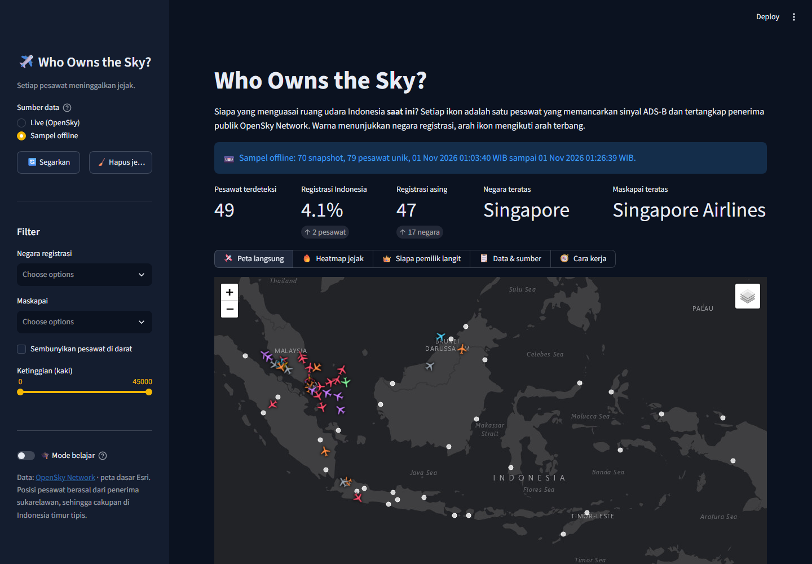
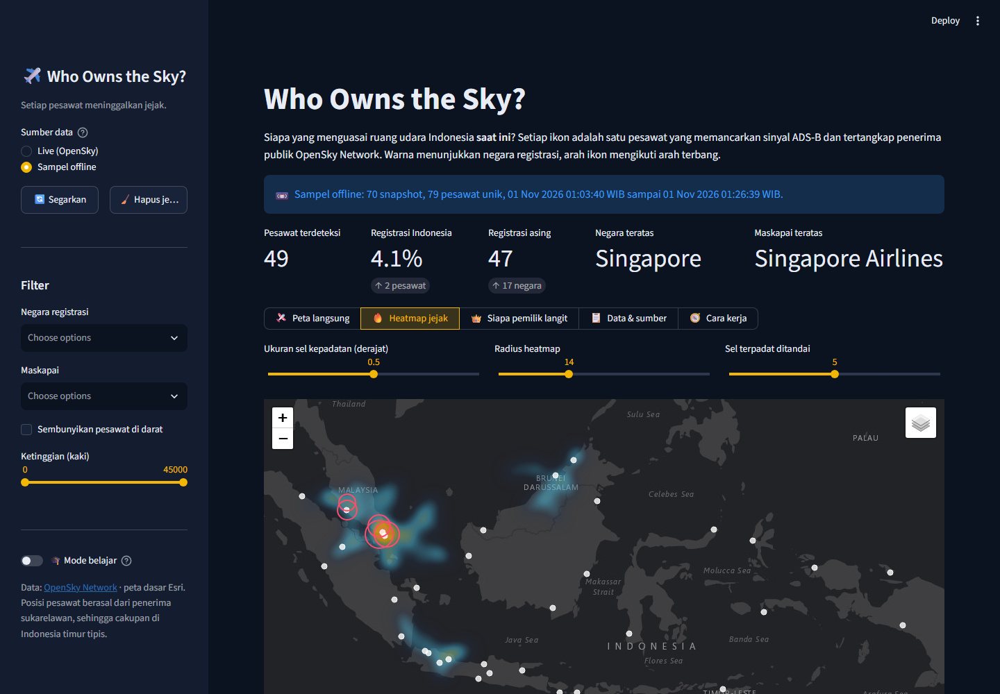
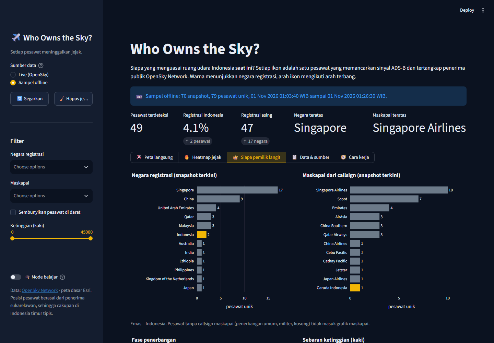
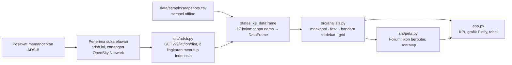

# ✈️ Who Owns the Sky?

> **Setiap pesawat meninggalkan jejak.** Peta langsung pesawat di atas Indonesia dari data ADS-B publik
> (adsb.lol, cadangan OpenSky Network), lengkap dengan heatmap koridor tersibuk dan jawaban atas satu pertanyaan sederhana:
> siapa yang sedang menguasai ruang udara kita saat ini? Dibangun dengan Python, pandas, Streamlit, Folium, dan Plotly.

*A live map of aircraft over Indonesia built from public ADS-B data (adsb.lol, OpenSky Network as fallback), with a heatmap of the
busiest corridors and a running answer to "who owns the sky right now?". Python, pandas, Streamlit, Folium, Plotly.
Ships with an offline sample so it works without internet.*

**🚀 Coba langsung di browser:** [who-owns-the-sky.streamlit.app](https://who-owns-the-sky.streamlit.app)



> ℹ️ **Disclaimer.** Seluruh data berasal dari **sumber publik** (adsb.lol, OpenSky Network, Wikipedia) dan bersifat edukatif.
> Ini bukan data operasional penerbangan dan tidak boleh dipakai untuk navigasi atau keputusan keselamatan.
> Proyek ini merupakan portofolio pribadi, tidak berafiliasi dengan adsb.lol, OpenSky Network, maskapai, maupun otoritas penerbangan.

## Latar belakang

Setiap pesawat komersial memancarkan posisinya lewat ADS-B, sinyal radio terbuka yang bisa ditangkap siapa saja dengan
antena murah. Jaringan seperti adsb.lol dan OpenSky Network mengumpulkan sinyal dari ribuan penerima sukarelawan dan
membukanya lewat API gratis.
Proyek ini mengambil potongan langit di atas Indonesia dari API tersebut setiap 30 detik, lalu bertanya: berapa banyak
pesawat yang terdaftar di Indonesia, berapa yang asing, maskapai mana yang paling banyak, dan koridor mana yang paling padat?

Sekaligus, proyek ini menjadi latihan tiga hal: memakai **API publik** dengan kuota terbatas (dan selalu menyiapkan
cadangan offline), mengubah **data mentah tanpa nama kolom** menjadi tabel yang bisa dianalisis, dan membuat **peta
interaktif** dengan ikon yang berputar mengikuti arah terbang.

## Fitur

| Tab | Isi |
|---|---|
| 🛩️ Live map | Satu ikon per pesawat, diwarnai per negara registrasi (Indonesia emas) dan diputar sesuai arah terbang. Klik untuk callsign, maskapai, fase, ketinggian, kecepatan, bandara terdekat. Lapisan bandara dan pesawat Indonesia/asing dapat dimatikan |
| 🔥 Trail heatmap | Heatmap dari seluruh posisi yang terekam (sampel offline, atau jejak yang terkumpul selama sesi live), tabel sel udara terpadat dengan label bandara terdekat, dan daftar jejak terpanjang |
| 👑 Who owns the sky | Grafik pesawat unik per negara registrasi dan per maskapai, fase penerbangan, sebaran ketinggian, dan perkiraan bandara tersibuk dari pesawat rendah di sekitarnya |
| 📋 Data & Sources | Tabel snapshot terkini, download CSV (snapshot atau seluruh jejak), daftar bandara acuan, sumber dan keterbatasan |
| 🧭 How it works | Diagram alur data dari pesawat sampai peta, tabel per langkah, penjelasan batas laju API |
| 🎓 Learning mode | Toggle di sidebar: setiap tab menampilkan expander berisi konsep (ADS-B, DivIcon berputar, grid kepadatan, pesawat unik, haversine) beserta potongan kode |

Sidebar menyediakan pilihan sumber data (**Live** dengan cadangan otomatis ke sampel bila sumber live gagal, atau
**Sampel offline**), tombol Refresh, serta filter negara, maskapai, ketinggian, dan pesawat di darat.

Mode live memakai [adsb.lol](https://adsb.lol): gratis, tanpa akun, dan dapat dihubungi dari Streamlit Community
Cloud. Dua lingkaran beradius 1.000 mil laut (`src/adsb.py`) menutup Sabang sampai Merauke; hasilnya digabung dan
dipotong ke kotak batas Indonesia. Bila adsb.lol menolak, aplikasi mencoba OpenSky Network (anonim, atau dengan akun
bila `OPENSKY_CLIENT_ID` dan `OPENSKY_CLIENT_SECRET` diisi sebagai variabel lingkungan atau di
`.streamlit/secrets.toml`), lalu sampel offline:

```toml
[opensky]
client_id = "..."
client_secret = "..."
```




## Cara menjalankan

```bash
git clone https://github.com/Avalon2222/who-owns-the-sky.git
cd who-owns-the-sky
python -m venv .venv && source .venv/bin/activate   # Windows: .venv\Scripts\activate
pip install -r requirements.txt
streamlit run app.py
```

Buka `http://localhost:8501`. Jalankan pengujian dengan `python -m pytest tests/ -v` (59 tes; otomatis jalan di GitHub Actions setiap push dan pull request).
Tanpa internet, pilih **Offline sample** di sidebar; peta dasar tetap memerlukan koneksi untuk mengunduh tile Esri.

Untuk merekam sampel baru (misalnya pada jam sibuk siang hari):

```bash
python scripts/kumpulkan_sampel.py --jumlah 60 --jeda 20
```

## Cara kerja (ringkas)



| Fungsi | Yang dilakukan |
|---|---|
| `adsb.ambil_semua()` | Dua permintaan HTTP ke adsb.lol dengan jeda 1 detik; lingkaran yang ditolak (HTTP 429) dilewati, semua gagal menjadi `AdsbError` |
| `adsb.ac_ke_dataframe(daftar, waktu)` | Gabung per alamat ICAO, kaki → meter, knot → m/s, tebak negara dari registrasi, buang baris di luar kotak batas |
| `opensky.ambil_states(bbox)` | Cadangan: satu permintaan HTTP ke OpenSky; HTTP 429 dan kegagalan jaringan menjadi `OpenSkyError` |
| `opensky.states_ke_dataframe(payload)` | Memberi nama 17 kolom OpenSky (dipakai sampel dan cadangan), membersihkan callsign, menambah waktu UTC |
| `maskapai.tebak_maskapai(callsign)` | 3 huruf kode ICAO → nama maskapai; pola registrasi → penerbangan umum |
| `analisis.fase_terbang(alt, laju_vertikal, di_darat)` | Di darat / Naik / Jelajah / Turun dari ambang 2,5 m/s |
| `analisis.perkaya(df, bandara)` | Menambah maskapai, fase, ketinggian kaki, km/jam, bandara terdekat (haversine) |
| `analisis.hitung_unik(df, kolom)` | Pesawat unik (icao24) per kategori, agar jejak tidak menggandakan hitungan |
| `analisis.grid_kepadatan(df, ukuran)` | Membagi peta menjadi sel 0,25–1° dan menghitung posisi serta pesawat unik per sel |
| `analisis.bandara_tersibuk(df, bandara)` | Pesawat rendah (< 3.500 m) dalam 60 km, dihitung hanya untuk bandara terdekatnya |
| `peta.ikon_pesawat(warna, arah)` | DivIcon SVG yang diputar dengan `transform: rotate()` sesuai arah terbang |

## Data

| File | Isi |
|---|---|
| `data/sample/snapshots.csv` | 70 snapshot OpenSky berjeda 20 detik, 3.344 baris, 79 pesawat unik, direkam 01 Nov 2026 pukul 01:03–01:26 WIB |
| `data/bandara.csv` | 36 bandara utama di dalam kotak batas (30 Indonesia + tetangga) dengan koordinat Wikipedia |
| `src/maskapai.py` | Pemetaan 60-an kode ICAO maskapai ke nama dan negara |

Sampel direkam pada dini hari WIB, saat penerbangan domestik sedang sepi dan lalu lintas Changi mendominasi.
Rekam ulang pada siang hari untuk gambaran yang berbeda. Catatan keterbatasan lengkap ada di
[`data/SUMBER_DATA.md`](data/SUMBER_DATA.md): cakupan penerima OpenSky tidak merata (Indonesia timur sering kosong),
hanya pesawat ber-ADS-B yang terlihat, dan `negara_asal` adalah negara registrasi, bukan negara maskapai.

## Catatan pengamatan (pendapat pribadi)

Dari sampel dini hari dan beberapa kali memantau mode live, beberapa hal yang menarik:

1. **"Langit Indonesia" pada dini hari sebagian besar bukan milik Indonesia.** Pesawat beregistrasi Indonesia hanya
   hanya sekitar 5–15% dari yang terdeteksi; sisanya pesawat Singapura, Tiongkok, Timur Tengah, dan Australia yang
   melintas atau menuju Changi. Siang hari angkanya berbalik karena penerbangan domestik aktif.
2. **Koridor terpadat bukan di Jawa, melainkan di sekitar Singapura dan Batam**, yang berada di dalam kotak batas
   dan dilayani penerimanya dengan sangat baik. Ini juga mengingatkan bahwa yang terlihat adalah *yang tertangkap
   penerima*, bukan seluruh lalu lintas.
3. **Rute lintasan jauh terlihat jelas sebagai garis lurus**: penerbangan Australia–Asia melintasi Kalimantan dan
   Sulawesi pada ketinggian jelajah tanpa pernah menyentuh bandara Indonesia.
4. **Kekosongan di Indonesia timur** pada peta lebih banyak bercerita tentang jumlah penerima OpenSky daripada
   tentang jumlah pesawat. Memasang satu penerima di Papua akan mengubah peta ini lebih banyak daripada kode apa pun.

## Struktur repositori

```
who-owns-the-sky/
├── app.py                      # tampilan Streamlit (dibaca dari atas ke bawah)
├── src/
│   ├── adsb.py                 # klien REST adsb.lol (sumber live utama) + tebakan negara registrasi
│   ├── opensky.py              # klien REST OpenSky (cadangan) + parser state vector
│   ├── maskapai.py             # kode ICAO callsign → maskapai
│   ├── analisis.py             # haversine, fase terbang, pesawat unik, grid, bandara tersibuk
│   ├── muat_data.py            # bandara, sampel offline, live-dengan-cadangan
│   └── peta.py                 # Folium: ikon berputar, heatmap, lapisan
├── scripts/kumpulkan_sampel.py # rekam N snapshot ke CSV
├── data/
│   ├── bandara.csv
│   ├── sample/snapshots.csv
│   └── SUMBER_DATA.md
├── docs/
│   ├── BELAJAR.md              # panduan belajar langkah demi langkah
│   ├── LATIHAN.md              # latihan bertingkat dengan kunci
│   └── screenshots/
├── tests/                      # 59 tes pytest: analisis, adsb, opensky
└── requirements.txt
```

## Belajar dari proyek ini

- [`docs/BELAJAR.md`](docs/BELAJAR.md): dari apa itu ADS-B, cara membaca respons API tanpa nama kolom, menebak
  maskapai dari callsign, sampai heatmap dan ikon berputar.
- [`docs/LATIHAN.md`](docs/LATIHAN.md): 10 latihan dari menambah bandara di CSV sampai membuat filter koridor dan
  tes baru, lengkap dengan petunjuk dan kunci.

## Lisensi

Kode berlisensi MIT. Data posisi pesawat live berasal dari [adsb.lol](https://adsb.lol) (lisensi
[ODbL](https://opendatacommons.org/licenses/odbl/)); sampel dan cadangan dari OpenSky Network tunduk pada
[ketentuan penggunaannya](https://opensky-network.org/about/terms-of-use) (non-komersial). Peta dasar oleh Esri.
