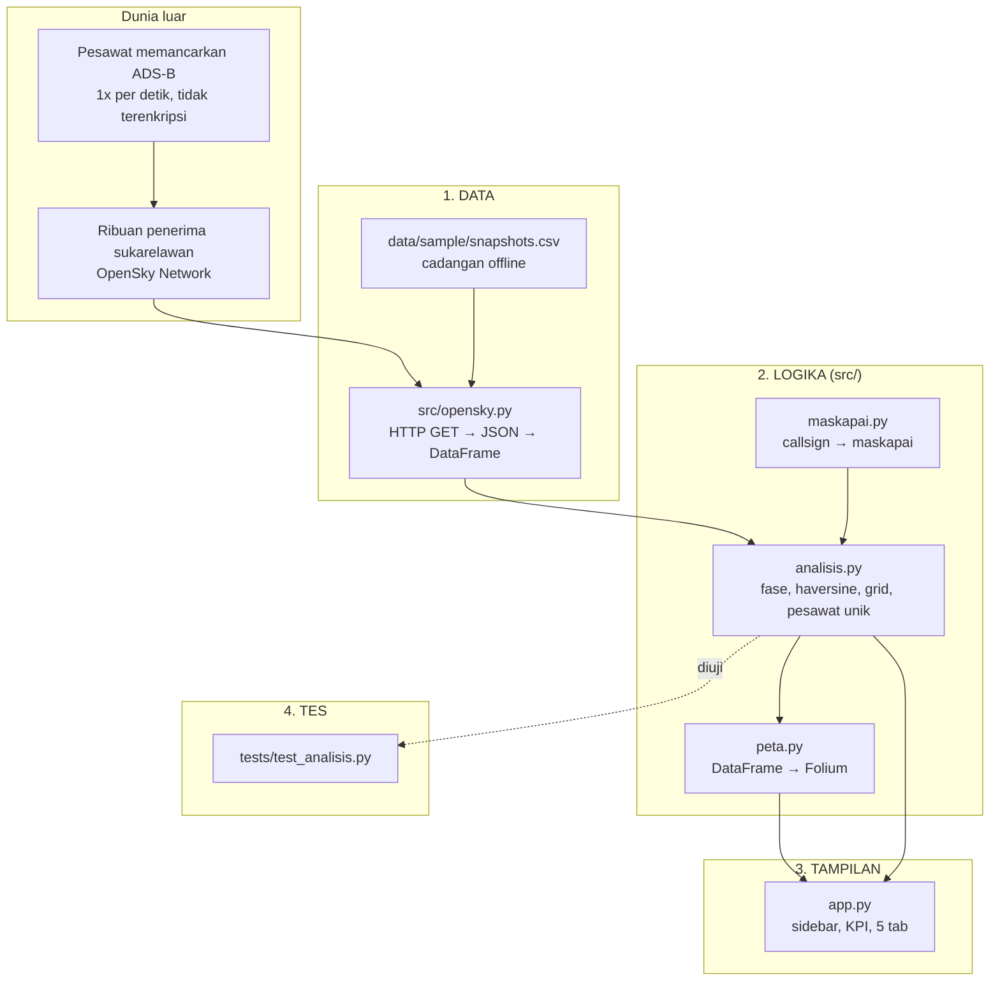

# 🎓 Panduan Belajar: Membaca Langit dengan Python

Panduan ini untuk pembaca yang sudah bisa menulis beberapa baris Python tetapi belum pernah memakai API publik,
pandas secara serius, atau membuat peta. Tujuannya bukan menghafal kode, melainkan memahami **mengapa** setiap
bagian ditulis demikian. Bacalah sambil membuka file yang disebut, dan ubahlah sesuatu di tiap langkah. Jika
rusak, `git checkout <nama file>` mengembalikannya.

Perkiraan waktu: 3–4 jam, dapat dibagi ke beberapa sesi.

---

## Gambaran besar



Pola ini sama dengan proyek data pada umumnya: **ambil → rapikan → hitung → tampilkan**, dengan tes yang menjaga
bagian "hitung". Streamlit hanya ada di `app.py`; seluruh `src/` bisa dijalankan tanpa Streamlit, yang membuatnya
mudah diuji dan dipakai ulang (misalnya dari skrip pengumpul sampel).

---

## Langkah 1 — Apa yang sebenarnya dipancarkan pesawat?

**ADS-B** (Automatic Dependent Surveillance–Broadcast) adalah pesan radio 1090 MHz yang dikirim pesawat kira-kira
sekali per detik. Isinya: alamat **ICAO 24-bit** (unik per badan pesawat, seperti nomor rangka), posisi GPS,
ketinggian, kecepatan, arah, dan laju naik/turun. Tidak ada enkripsi, sehingga penerima seharga beberapa ratus ribu
rupiah (dongle RTL-SDR) sudah bisa mendengarnya dalam radius 200–400 km.

Beberapa istilah yang akan sering muncul:

| Istilah | Arti | Kolom di aplikasi |
|---|---|---|
| icao24 | alamat transponder heksadesimal, misalnya `8a01af`. Blok awal menunjukkan negara registrasi (`8a` = Indonesia) | `icao24`, `negara_asal` |
| callsign | tanda panggil penerbangan, misalnya `GIA412`; bisa kosong | `callsign` |
| baro altitude | ketinggian dari tekanan udara standar, meter | `alt_baro_m` |
| velocity | kecepatan terhadap tanah, m/s | `kecepatan_ms` |
| true track | arah terbang, derajat searah jarum jam dari utara | `arah` |
| vertical rate | laju vertikal, m/s, positif = naik | `laju_vertikal` |
| on ground | True jika di landasan | `di_darat` |

**OpenSky Network** menggabungkan laporan dari ribuan penerima dan menyajikan "state vector" terakhir setiap pesawat.
Akses anonim gratis tetapi dibatasi kuota (sekitar 400 kredit per hari). Satu kotak seluas Indonesia berbiaya 4
kredit, jadi kira-kira 100 permintaan per hari. Angka ini yang memaksa kita punya cache dan sampel offline.

> Coba: buka di browser
> `https://opensky-network.org/api/states/all?lamin=-11.5&lomin=94.5&lamax=6.5&lomax=141.5`
> Anda akan melihat JSON mentah persis seperti yang diterima aplikasi.

---

## Langkah 2 — Dari JSON tanpa nama kolom ke DataFrame (`src/opensky.py`)

Respons OpenSky terlihat seperti ini:

```json
{"time": 1793469804,
 "states": [["8a01af", "LNI890  ", "Indonesia", 1793469803, 1793469803, 107.1693, -6.3673, 5798.82, false, 204.14, 103.41, 10.4, null, 6164.58, "2415", false, 0], ...]}
```

Setiap pesawat adalah **daftar 17 nilai tanpa nama**. Urutannya hanya dijelaskan di dokumentasi. Karena itu langkah
pertama adalah memberi nama:

```python
KOLOM_STATE = ["icao24", "callsign", "negara_asal", "waktu_posisi", "waktu_kontak", "lon", "lat",
               "alt_baro_m", "di_darat", "kecepatan_ms", "arah", "laju_vertikal", "sensor",
               "alt_geo_m", "squawk", "spi", "sumber_posisi"]
df = pd.DataFrame(states, columns=KOLOM_STATE)
```

Perhatikan tiga hal kecil yang sering jadi sumber bug:

1. **Urutan `lon` lalu `lat`.** OpenSky menaruh bujur (indeks 5) sebelum lintang (indeks 6), sedangkan Folium
   memakai `(lat, lon)`. Tertukar sedikit saja, pesawat Anda berada di Samudra Hindia selatan Afrika.
2. **Callsign berisi spasi di kanan** (`"LNI890  "`). `str.strip()` wajib, kalau tidak `"LNI890  " != "LNI890"`.
3. **Nilai kosong adalah `null`/`None`**, bukan 0. Pesawat di darat sering tidak punya ketinggian. `pd.to_numeric(...,
   errors="coerce")` mengubahnya menjadi `NaN` yang bisa dihitung dengan aman (`mean` mengabaikannya).

Fungsi `states_ke_dataframe` juga menambah kolom `waktu_snapshot` (unix time dari kunci `time`). Kolom ini yang
nantinya memungkinkan banyak snapshot digabung menjadi satu tabel "jejak" tanpa kehilangan informasi kapan tiap
baris diambil.

**Menangani kegagalan.** `ambil_states` mengubah semua kegagalan (jaringan putus, HTTP 429 kuota habis, JSON rusak)
menjadi satu jenis kesalahan: `OpenSkyError`. Dengan begitu `muat_live_atau_sampel` cukup menulis satu `except`:

```python
try:
    df = opensky.ambil_dataframe()
    return df, "live", "..."
except opensky.OpenSkyError as exc:
    return snapshot_terakhir(muat_sampel()), "sampel", f"{exc} Menampilkan sampel offline."
```

Prinsipnya: **aplikasi tidak boleh mati hanya karena sumber eksternal mati.** Pengguna cukup melihat pesan oranye.

---

## Langkah 3 — Menebak maskapai dari callsign (`src/maskapai.py`)

Callsign penerbangan berjadwal berbentuk `<3 huruf kode ICAO><nomor>`: `GIA412` adalah Garuda 412, `TGW560`
adalah Scoot 560. Kode ICAO berbeda dengan kode IATA 2 huruf di tiket (GA, TR). Cukup satu kamus dan satu regex:

```python
MASKAPAI = {"GIA": ("Garuda Indonesia", "Indonesia"), "TGW": ("Scoot", "Singapura"), ...}
_POLA_ICAO = re.compile(r"^([A-Z]{3})[0-9][0-9A-Z]{0,4}$")
```

Regex itu dibaca: tiga huruf kapital, lalu satu angka, lalu 0–4 angka/huruf. `LNI890` cocok, `PK-LQH` tidak.
Callsign berpola registrasi (`PK-...` Indonesia, `9V-...` Singapura, `VH-...` Australia) dikelompokkan sebagai
"Registrasi / penerbangan umum", sisanya "Tidak dikenal".

Ini **tebakan**, bukan kebenaran. Kamus tidak lengkap, dan ada maskapai yang memakai callsign alfanumerik tidak baku.
Karena itu di grafik maskapai, kategori "Tidak dikenal" sengaja dikeluarkan agar tidak menyesatkan, tetapi tetap ada
di tabel data.

> Coba: tambahkan satu maskapai ke kamus, lalu jalankan `python -m pytest tests/ -k maskapai`. Tes
> `test_semua_kode_icao_tiga_huruf_kapital` akan menangkap jika Anda salah ketik kodenya menjadi 4 huruf.

---

## Langkah 4 — Fase terbang dan jarak (`src/analisis.py`)

**Fase terbang** ditebak dari dua angka:

```python
if di_darat: return "Di darat"
if alt_m < 300 and abs(lv) < 2.5: return "Di darat"
if lv > 2.5: return "Naik"
if lv < -2.5: return "Turun"
return "Jelajah"
```

Ambang 2,5 m/s setara 500 kaki/menit, batas yang lazim dipakai pilot untuk membedakan "sedang naik/turun" dengan
goyangan kecil saat jelajah. Angka seperti ini disebut **heuristik**: aturan praktis yang cukup baik, bukan definisi
resmi. Tes `test_fase_terbang` mencatat perilaku yang diharapkan agar perubahan ambang di kemudian hari disengaja.

**Haversine** menghitung jarak dua koordinat di permukaan bola:

```python
a = sin²(Δφ/2) + cos φ1 · cos φ2 · sin²(Δλ/2)
d = 2R · asin(√a),   R = 6371 km
```

Dipakai untuk "bandara terdekat" setiap pesawat. Ada dua versi: `haversine_km` (satu pasangan, mudah dibaca) dan
`haversine_vektor` (satu titik terhadap ribuan titik sekaligus memakai NumPy). Versi vektor 100 kali lebih cepat,
tetapi versi skalar lebih mudah diuji; keduanya dibandingkan di `test_haversine_vektor_sama_dengan_skalar`.

> Coba: tes `test_haversine_cgk_dps_sekitar_983_km` memeriksa jarak Soekarno-Hatta ke Ngurah Rai. Ganti `R_BUMI_KM`
> menjadi 6400 dan lihat tes mana yang gagal. Itulah gunanya tes: perubahan kecil terlihat seketika.

---

## Langkah 5 — Menghitung pesawat, bukan baris

Ini konsep terpenting di proyek ini. Setelah snapshot digabung menjadi jejak, **satu pesawat muncul berkali-kali**.
Kalau Anda menghitung `len(df[df.negara_asal == "Indonesia"])`, pesawat Garuda yang terekam 60 kali akan terlihat
seperti 60 pesawat.

```python
df.groupby("negara_asal")["icao24"].nunique()
```

`nunique()` menghitung alamat ICAO yang berbeda. Fungsi `hitung_unik` membungkusnya dan menambah persen. Tes
`test_hitung_unik_tidak_menggandakan_jejak` menggandakan snapshot dan memastikan angkanya tidak berubah.

Hal yang sama berlaku untuk `grid_kepadatan`, yang mengembalikan **dua** ukuran per sel: `titik` (semua posisi;
pesawat yang berputar menunggu mendarat menumpuk di sini) dan `pesawat` (unik). Keduanya berguna, asal tidak tertukar.

---

## Langkah 6 — Grid kepadatan: "rute" dari sekumpulan titik

Satu snapshot hanya berisi posisi sesaat. Tetapi 60 snapshot berjeda 20 detik dari pesawat berkecepatan 850 km/jam
membentuk 60 titik sepanjang 280 km. Ratusan pesawat menggambar koridor dengan sendirinya.

Grid kepadatan membulatkan koordinat ke bawah ke kelipatan ukuran sel, lalu menghitung per sel:

```python
g["lat_sel"] = np.floor(g["lat"] / 0.5)      # -6.37 → -13  (sel -6.5 s.d. -6.0)
g["lon_sel"] = np.floor(g["lon"] / 0.5)      # 107.17 → 214 (sel 107.0 s.d. 107.5)
agg = g.groupby(["lat_sel", "lon_sel"]).agg(titik=("icao24", "size"), pesawat=("icao24", "nunique"))
```

`np.floor` penting untuk koordinat negatif: `int(-6.37 / 0.5)` memberi -12 (membulat ke nol), sedangkan
`floor` memberi -13 (membulat ke bawah). Tanpa `floor`, sel di belahan selatan dan utara khatulistiwa berbeda lebar.
Tes `test_grid_kepadatan_mengelompokkan_titik_berdekatan` memeriksa titik tengah sel persis -6,5 / 107,5.

Heatmap Folium (`folium.plugins.HeatMap`) melakukan hal serupa secara visual di browser: tiap titik menjadi
lingkaran kabur, dan tumpang tindih lingkaran menghasilkan warna lebih panas.

---

## Langkah 7 — Ikon pesawat yang berputar (`src/peta.py`)

Folium tidak punya marker pesawat. Trik yang dipakai: **DivIcon**, yaitu marker berisi HTML bebas. Kita masukkan
SVG pesawat (jalur Material "flight", hidung ke atas) dan putar dengan CSS:

```python
svg = f'<svg ... style="transform: rotate({arah:.0f}deg)"><path d="..." fill="{warna}"/></svg>'
folium.DivIcon(html=svg, icon_size=(22, 22), icon_anchor=(11, 11))
```

Dua detail:

- `arah` OpenSky adalah derajat searah jarum jam dari utara, dan `rotate()` CSS juga searah jarum jam. Karena SVG-nya
  menghadap utara, tidak perlu konversi.
- `icon_anchor=(11, 11)` menaruh titik koordinat di **tengah** ikon. Default-nya sudut kiri atas, yang membuat ikon
  bergeser saat diputar.

Warna mengikuti **kelompok negara registrasi** (7 warna, Indonesia emas), bukan 15 negara terpisah, agar legenda tetap
bisa dibaca. Identitas lengkap tetap tersedia di tooltip dan popup, jadi warna bukan satu-satunya penanda.

---

## Langkah 8 — Streamlit: cache, session state, dan kuota

Tiga fitur Streamlit yang menyelamatkan kuota OpenSky:

```python
@st.cache_data(ttl=30)
def live_df(): ...
```

`ttl=30` berarti panggilan kedua dalam 30 detik tidak menghubungi OpenSky sama sekali. Setiap interaksi (menggeser
slider, mengganti tab) menjalankan ulang seluruh `app.py` dari atas; tanpa cache, satu kali geser slider = satu
kredit terbuang.

```python
st.session_state["jejak_live"] = jejak
```

`session_state` bertahan antar-rerun dalam satu sesi browser. Di mode live, tiap snapshot baru ditambahkan ke sini
sehingga heatmap "tumbuh" selama Anda menonton, dibatasi 120 snapshot agar memori tidak membengkak.

Tombol **Segarkan** memanggil `live_df.clear()`, yang membuang cache agar permintaan berikutnya benar-benar baru.

---

## Langkah 9 — Tes sebagai jaring pengaman

`tests/test_analisis.py` berisi 38 tes yang berjalan di bawah satu detik. Polanya:

- **Data uji kecil yang dibuat sendiri** (`PAYLOAD` dengan 6 pesawat), bukan data live, supaya hasilnya pasti.
- **Satu klaim per tes**, dengan nama yang menjelaskan klaimnya: `test_states_ke_dataframe_membuang_baris_tanpa_koordinat`.
- **`pytest.approx`** untuk angka pecahan, karena `0.1 + 0.2 != 0.3` di komputer.
- **`parametrize`** untuk mencoba satu fungsi dengan banyak masukan tanpa menyalin kode.

Jalankan `python -m pytest tests/ -v` sebelum dan sesudah tiap perubahan. Jika semua hijau, Anda boleh percaya diri;
jika ada yang merah, pesan kegagalannya biasanya langsung menunjuk baris yang salah.

---

## Ke mana setelah ini?

- Kerjakan [`LATIHAN.md`](LATIHAN.md), dari yang hanya mengubah CSV sampai menulis fungsi dan tes baru.
- Baca dokumentasi OpenSky tentang endpoint `/tracks` dan `/flights/arrival` (perlu akun) untuk mendapatkan
  rute asal-tujuan yang sebenarnya, bukan tebakan dari posisi.
- Pasang penerima ADS-B sendiri (RTL-SDR + antena) dan bagikan datanya ke OpenSky; Anda akan mendapat kuota lebih
  besar dan, lebih penting, menambah cakupan di Indonesia.
